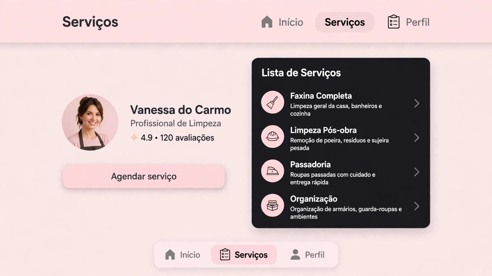

# [DIARISTA PROFISSIONAL]

Este projeto tem como objetivo servir como aplicação dentro de um site com o propósito de apresentar as habilidades, experiências, disponibilidades bem como as características e perfil profissional de uma pessoa. Tendo partes de aplicação para planos, pedido de serviços, combinados , demonstração de experiência e amostra do antes e do depois.  

## 🚀 Começando
<ol>
<li> Vá até a aba [Code] deste repositório e copie o link do mesmo; </li>
<li> Em seu terminal digite o comando git clone;</li>
<li> Cole o link copiado no repositório;</li>
<li> Pressione a tecla [Enter];
Obs: Certifique-se de estar no diretório que deseja instalar o projeto;</li>
<li>Ao finalizar a cópia do projeto acesse index.html;</li>
</ol>

### 📋 Pré-requisitos [DIGA O QUE É PRECISO OU INDISPENÁVEL PARA O PROJETO FUNCIONAR]

Como pré requisito , faz-se necessário somente ter um navegador de sua preferência instalado.

Chrome , Fire Fox, Edge , Safari , Opera etc.

### 🔧 Instalação 

Não tem um navegador instalado ? Siga essas dicas. Daremos o passo a passo da instalação do navegador Chrome, caso deseje outro navegador como alguns dos citados anteriormente, não se preocupe, os passos que seguirá para instala-los serão semelhantes.

Como instalar o navegador Chrome:

 <ol>
<li>Fazer login no navegador Chrome.</li>
<li>Definir o Chrome como o navegador padrão.</li>
<li>Definir a página inicial.</li>
 <li>Definir a página de inicialização.</li>
<li>Definir um local de download padrão.</li>
 <li>Importar seus favoritos do navegador antigo.</li>
<li>Criar perfis para contas pessoais e de trabalho.</li> 
</ol>

Após o download em sua máquina os passos anteriores são o suficiente para que possamos acessar o Chrome de maneira confortável.

## 📦 Implantação

* Somente estático não é necessário nenhuma fonte externa.
* Codificado com as linguagens HTML,CSS e JAVASCRIPT.

## Observações
* Neste projeto, foi utilizado manipulação do DOM , laços de repetição, carregamento preload para obter ações da necessidade do usuário;

* Aprendi muito com a utilização de eventos de clik, no Java script captando ações em elementos html.

* Foi fundamental para intender a integração da camada estrutural, camada de apresentação e a camada de comportamento.

## Objetivo

* O que preciso fazer? - quando clicar no botão de opçãp na página home, o usuário é levado a opção desejada.

* OBJETIVO 1 - quando clicar no botão de opção na lista, marcar o botão como selecionado. 
     <ol>
       <li>Passo - pegar os botões no JS pra poder verificar quando o usuário clicar em cima de um deles</li> 
       <li>Passo - adicionar a classe "selecionado" no botão que o usuário clicou.</li> 
       <li>Passo - verificar se já existe um botão selecionado, se sim, devemos remover a seleção.</li>  
      </ol>
* OBJETIVO 2 - quando clicar no botão da lista com as opções de menu mostrar as informações desejadas do profissional
      <ol>
      <li>Passo - acessar os itens de menu no JS pra poder mostrar ou esconder as opções de lista.</li> 
       <li>Passo  - adicionar a classe "selecionado" de opção de menu que o usuário selecionou.</li> 
       <li>Passo - verificar se já existe uma opção selecionada, se sim, devemos remover a seleção de lista.</li>  
     </ol>
         

## 🛠️ Construído com

Foi utilizado um navegador web, e uma I.D.E.

* [Chrome](https://www.google.com/chrome/) - O navegador web usado
* [Vscode](https://code.visualstudio.com/download) - Ambiente de desenvolvimento integrado   

## 🖇️ Colaborando

Por favor, leia o [COLABORACAO.md](https://gist.github.com/usuario/linkParaInfoSobreContribuicoes) para obter detalhes sobre o nosso código de conduta e o processo para nos enviar pedidos de solicitação.

## ✒️ Autores

Eu Alberdam Santiago dei inicio ao projeto e também a conclusão juntamente com
Moisés Parreira de Mendonça e Washington Luis de Assis Pereira.

* **Um desenvolvedor** - *Trabalho Inicial* - [Alberdam Santiago]

## 📄 Licença

Este projeto está sob a licença (Alberdam Santiago) - veja o arquivo [LICENSE.md](https://github.com/usuario/projeto/licenca) para detalhes.

## 🎁 Expressões de gratidão

* Conte a outras pessoas sobre este projeto 📢;
* Convide alguém da equipe para um refrigeirante 🥤;
* Um agradecimento publicamente 🧑‍🎤;
* etc.

---
Codificado com amor por [Alberdam Santiago](https://github.com/hunter-code 😊)